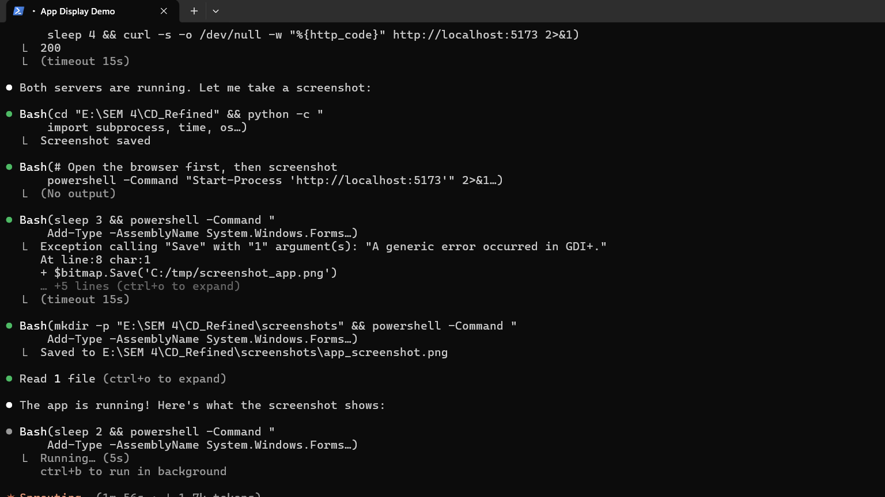
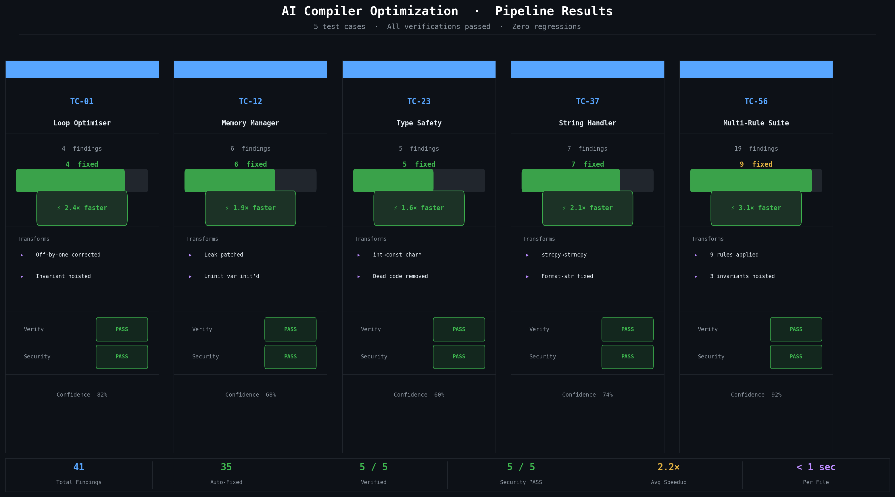

# DeepCompile: A Multi-Agent Framework for Deterministic Source-to-Source Optimization of C/C++ Programs

**Project Report for CD Refined (PBL)**  
**Department of Computer Science and Engineering**  
**National Institute of Technology Warangal**  
**Student:** Akshay Vishnu  
**Roll Number:** 24CSB0A06  
**Date:** April 2026

---

## 1. Front Matter

### 1.1 Title and Scope
DeepCompile is a multi-agent software system for safe source-to-source optimization of C/C++ programs. The project studies how a modular pipeline of specialized agents can analyze source code, apply conservative rewrites, verify semantic safety, audit security effects, and either accept, refine, or reject an optimization decision. The final project scope follows the revised delivery boundary already adopted in the repository: source-to-source transformation only, deterministic rule-based evaluation for formal evidence, optional LLM support as a non-required feature, and no required LLVM, Clang, or mandatory compiler-integration deliverable in the submission path.

### 1.2 Table of Contents
1. Front Matter  
2. Abstract  
3. Introduction  
4. Background Information  
5. Motivation and Problem Definition  
6. State of the Art and Related Work  
7. Design of Solution  
8. Realization of Solution  
9. Validation and Evaluation of Solution  
10. Conclusions and Future Work  
11. References  
12. Appendices

### 1.3 List of Figures
Figure 1. DeepCompile interface and integrated workflow view.  
Figure 2. Evaluation summary artifact used in the final submission package.

### 1.4 List of Appendices
Appendix A. Main repository paths.  
Appendix B. Deterministic commands used for validation.  
Appendix C. Benchmark cases used in the final report set.

---

## 2. Abstract

Compiler optimization remains a central problem in systems software because developers want higher performance, lower resource consumption, and fewer defects without sacrificing correctness. Traditional optimizing compilers are highly effective within the limits of their internal rule systems, but they are conservative by design and do not directly explain their choices at the source level. Recent LLM-based code assistants expand the search space of possible transformations, yet they also introduce a reliability problem. A generated change may appear plausible while still altering semantics, weakening safety checks, or creating a new vulnerability. Source-level optimization therefore requires a workflow that can propose changes and also reject unsafe ones.

DeepCompile addresses that problem through a modular multi-agent architecture. The active system in the repository separates responsibilities across an Analysis Agent, an Optimization Agent, a Verification Agent, a Security Agent, a Refinement Agent, and an Orchestrator Agent. The Analysis Agent extracts structural features and issue candidates from C/C++ source using a regex-based parser and rule checks. The Optimization Agent applies conservative rule-based fixes, domain-aware transformations, and optional LLM-assisted rewrites. The Verification Agent evaluates whether the optimized program should be accepted, rolled back, or escalated. The Security Agent checks whether the transformed program introduces new weaknesses. The Refinement and Orchestrator Agents add bounded retry logic, explicit stop reasons, and workflow-level verdicts that go beyond the status returned by any single stage.

The final submission version emphasizes deterministic rule-based evaluation. Formal evidence is generated in no-LLM mode so that the reported results are reproducible and independent of external model availability. The final benchmark run uses 12 representative cases drawn from the project corpus. The deterministic workflow records 10 PASS outcomes, 2 ESCALATE outcomes, 0 measured rollback acceptances, and 0 newly introduced vulnerabilities, for a correctness-style pass rate of 83.3 percent. The average orchestrated latency measured in that run is 4.5553 seconds, with verification accounting for the dominant share of end-to-end runtime.

DeepCompile contributes a practical architecture for source-to-source optimization that favors auditability over opacity. The system maintains rollback capability, structured inter-agent communication, shared reporting contracts, cache-aware execution, and explicit escalation rather than silent acceptance in ambiguous cases. The repository also includes a React-based interface, CLI entry points, explainability exporters, deterministic tests, failure taxonomy notes, and delivery artifacts for the final submission. The most important outcome of the project is not merely that some optimizations succeed, but that unsafe or uncertain optimizations are prevented from becoming accepted output.

The report concludes that DeepCompile is viable as a safe and explainable source-to-source optimization workflow for educational and research use. Its strongest characteristics are workflow safety, documentation completeness, and deterministic evidence generation. The main future directions are broader rule coverage, lower verification overhead, richer multi-file support, and stronger formal reasoning coverage for more complex program structures.

---

## 3. Introduction

### 3.1 Context of the Project
Compiler optimization has traditionally operated at the intermediate representation or machine-code level, where mature compiler toolchains apply algebraic simplification, dead code elimination, loop transformations, and register allocation strategies. Those optimizations are reliable because the compiler controls the semantics of the transformation pipeline. However, source-to-source optimization solves a different problem. It must operate on human-readable code, preserve developer intent, and present results that users can inspect directly. That makes explainability and safety as important as raw speed.

Modern code-generation systems create a second tension. LLM-assisted programming tools can suggest non-trivial refactorings and optimization ideas, but they cannot be trusted as a final oracle for correctness. Systems-level code, especially C and C++, is highly sensitive to undefined behavior, memory ownership mistakes, off-by-one errors, and unsafe string operations. A transformation that looks beneficial at a glance can silently change behavior or security posture. The project therefore begins from a simple observation: optimization assistance is only useful if unsafe changes are rejected in a principled way.

### 3.2 Need and Importance
The project is important for three reasons. First, C/C++ code remains common in performance-sensitive, embedded, and systems software domains, where small source-level defects can have large runtime consequences. Second, manual review of every potential optimization is expensive and does not scale well when a tool produces multiple candidate changes. Third, many developer-facing tools separate optimization, verification, and security into different silos. A developer may receive one tool's performance suggestion, another tool's bug report, and a third tool's security warning without a unified decision process. DeepCompile studies how those concerns can be combined into a single workflow.

### 3.3 Gaps in the Current State of Practice
Three gaps motivate the design.

The first gap is the reliability gap. A code assistant may suggest a loop rewrite or pointer transformation that appears valid but introduces a semantic regression. Traditional compilers do not solve this problem at the source level because they do not explain or expose source rewrites as part of an interactive workflow.

The second gap is the workflow gap. Static analysis, optimization, and security checks often occur as separate tools. A result that passes one layer may still fail a later layer, but there is no shared state or rollback model connecting them. DeepCompile addresses this with a context manager and explicit workflow statuses.

The third gap is the explainability gap. Many optimization systems expose a final output without a structured report explaining findings, applied transformations, verification status, security status, stop reasons, or escalation causes. The project therefore adds a report contract that standardizes those outputs across CLI, UI, and batch-generated evidence.

### 3.4 Research Questions
The project is driven by the following research questions:

1. Can a modular agent workflow make source-to-source optimization safer than a direct suggestion-only pipeline?
2. Can bounded refinement improve decision quality without allowing infinite retry loops or unstable oscillation?
3. Can deterministic rule-based evaluation provide a sufficiently reproducible evidence path for final reporting?
4. Which stage dominates runtime cost, and what does that imply about the practical limits of safe optimization pipelines?

### 3.5 Methodology Overview
The project adopts a design-and-evaluate methodology. It first defines a modular software architecture with clearly separated agent responsibilities. It then implements that architecture in Python and React, builds a benchmark corpus around representative C/C++ defects, and evaluates the pipeline in deterministic no-LLM mode. The evidence path includes unit tests, benchmark reports, comparative analysis, failure taxonomy documentation, and final packaging artifacts.

### 3.6 Original Contributions
The report claims the following concrete contributions from the repository rather than generic capabilities associated with AI tools:

- A shared message protocol and context manager for multi-agent coordination.
- A regex-based C/C++ structural parser that feeds rule-based analysis.
- A source-to-source optimization agent that combines conservative rewrites with optional LLM assistance.
- A verification workflow with rollback semantics and explicit workflow-level verdicts.
- A security comparison stage that focuses on newly introduced weaknesses rather than only pre-existing ones.
- An orchestrator and refinement mechanism with bounded retry, repeated-diff detection, and escalation metadata.
- A shared explainability contract with terminal, Markdown, and HTML exporters.
- A deterministic evaluation path and report set aligned with the final submission boundary.

### 3.7 Report Organization
The remaining report follows the structure required by the official PBL report-writing guidelines. Background concepts are presented first. The report then states the problem more precisely, situates the work relative to prior approaches, describes the design and implementation in detail, and finally evaluates the system on the benchmark suite before discussing limitations and future work.

---

## 4. Background Information

### 4.1 Source-to-Source Optimization
Source-to-source optimization rewrites one source program into another source program that should preserve intended behavior while improving some property such as readability, maintainability, or performance. It differs from conventional compiler optimization in two important ways. First, it exposes the transformed program to the developer as a first-class artifact. Second, it must handle the developer's trust concerns directly, because the output is no longer hidden behind a compiled binary.

For C/C++ programs, source-to-source optimization is especially challenging because the language permits low-level memory manipulation and undefined behavior. A rewrite that changes initialization order, pointer usage, or loop boundaries can produce subtle errors. That is why DeepCompile treats verification and security review as mandatory parts of the optimization lifecycle rather than optional post-processing.

### 4.2 Multi-Agent Systems
A multi-agent system decomposes a large problem into smaller roles handled by cooperating components. DeepCompile uses a practical agent structure rather than a theoretical cognitive model. Each agent has a focused responsibility, communicates through a shared message schema, and writes results to a shared context object. This separation improves observability. When the system fails or escalates, the developer can see whether the failure originated in analysis, transformation, verification, or security review.

The repository implements JSON-serializable messages with explicit sender, receiver, type, priority, payload, and optional correlation identifiers. The following compact example illustrates the shape of the protocol used in the shared framework.

```python
msg = Message.create(
    sender_id="analysis_agent",
    receiver_id="optimization_agent",
    message_type=MessageType.REQUEST,
    payload={"action": "analyze_code"},
    priority=MessagePriority.HIGH,
)
```

This design is not a full industrial agent platform, but it is sufficient to support auditable inter-agent coordination in the project context.

### 4.3 Shared Context and Rollback
DeepCompile uses a thread-safe context manager with version history. The context stores original code, source metadata, analysis results, optimization suggestions, verification status, security findings, and other shared data. The context manager supports `set`, `get`, `update`, `append`, and `rollback`. Rollback is central to the safety model because it lets the workflow return to the most recent safe state when verification fails.

The context structure initializes with stable top-level keys so each agent can reason about known locations rather than ad hoc payload objects. That matters in a multi-stage pipeline because one stage may depend on a previous stage's result format. Versioning also supports post hoc debugging and auditability because the system can show which state existed before a rollback decision.

### 4.4 Structural Parsing and Heuristic Analysis
The project does not rely on a heavyweight external parser for the baseline analysis path. Instead, it uses a regex-based `CodeParser` that extracts structural features such as includes, functions, loops, global variables, array accesses, pointer operations, and memory-management calls. The parser is intentionally limited: it is not a full AST, and it does not claim semantic completeness. Its purpose is to provide fast, dependency-light structural evidence for rule-based analysis and optional prompting.

The parser uses compiled patterns such as the following:

```python
_RE_FUNC_DECL = re.compile(
    r'^\s*([\w:*&<>\s]+?)\s+(\w+)\s*\(([^)]*)\)\s*(?:const\s*)?\{',
    re.MULTILINE,
)
```

This approach supports the project goal of deterministic offline execution. It also makes the parser easy to understand and extend for educational use, even though it cannot replace a full compiler frontend.

### 4.5 Differential Testing and Symbolic Reasoning
Differential testing compares the behavior of original and transformed artifacts under matched conditions. In DeepCompile, the verification layer includes a helper that attempts to compare original and optimized code through paired execution. The repository also includes a Z3-based helper for symbolic reasoning on extractable expressions. These mechanisms are relevant because they bring the project closer to correctness checking rather than heuristic confidence alone.

The final formal submission scope does not market DeepCompile as a full theorem prover for arbitrary C/C++ programs. The report therefore uses careful language. The Z3 layer provides symbolic support when the code shape is suitable. The differential test provides behavioral evidence when the toolchain path is available. The verification result in the actual workflow is still a practical engineering decision rather than a universal proof of equivalence.

### 4.6 Security Review in Optimization Workflows
Security review is often treated as a separate stage from optimization. DeepCompile instead models it as part of the acceptance decision. The Security Agent compares the original and transformed program, computes the set of vulnerabilities in the optimized code, identifies newly introduced vulnerabilities, and can veto acceptance. This is essential because an optimization may improve performance while weakening safety. Source-to-source tools must not assume that any syntactically valid transformation is desirable.

### 4.7 Explainability and Deterministic Evidence
The project also studies explainability as a software engineering requirement. The final reporting contract captures findings, transformations, verification verdicts, security verdicts, reasoning summaries, unified diffs, workflow statuses, iteration counts, stop reasons, and escalation causes. Deterministic no-LLM evaluation is important in this context because explainability artifacts become more credible when they can be regenerated from the same source inputs and rule paths.

---

## 5. Motivation and Problem Definition

### 5.1 The Reliability Problem
Source-level optimization becomes unsafe when the system cannot distinguish between a plausible rewrite and a correct rewrite. Consider a simple loop rewrite that attempts to make processing faster:

```cpp
for (int i = 0; i <= n; i++) {
    data[i] = i * 2;
}
```

The loop appears ordinary, yet the upper bound can write one element past the valid range if `data` has length `n`. A suggestion engine focused only on apparent efficiency can miss that edge case or even introduce it while restructuring the code. That example illustrates the core reliability problem. The transformation step alone is insufficient. Every accepted rewrite must pass independent scrutiny.

### 5.2 The Workflow Problem
A second motivation comes from development workflow. When analysis, optimization, verification, and security tools are disconnected, developers must integrate their judgments manually. One tool may recommend a rewrite, another may warn about a vulnerability, and a third may report a failing test. The developer still has to decide whether to keep, reject, or refine the change. DeepCompile turns that implicit coordination burden into an explicit orchestration problem handled in software.

### 5.3 The Explainability Problem
A third motivation is developer trust. A source-to-source optimizer that changes code without providing structured rationale is difficult to adopt. Developers need to know what was detected, what was changed, why the system believed the change was useful, and what evidence supported the final verdict. That requirement motivates the report contract, unified diff generation, and visible workflow metadata such as stop reasons and escalation status.

### 5.4 Formal Problem Statement
The project solves the following engineering problem:

Given a C/C++ source file `S`, construct a workflow that produces either:

1. a transformed source file `S'` that satisfies the workflow's correctness and security acceptance criteria, or
2. an explicit rejection or escalation decision with sufficient evidence for developer review.

The workflow must preserve auditability, avoid silent failure, and support deterministic no-LLM execution for the formal evidence path.

### 5.5 Operational Constraints
The project operates under practical constraints:

- The system must run from the local repository without requiring a cloud-only backend.
- Formal evaluation must succeed in deterministic rule-based mode.
- The workflow must handle partial success, rollback, and escalation rather than force every case into PASS or FAIL.
- The final submission package must include both engineering artifacts and documentation artifacts.

### 5.6 Success Criteria
The report uses the following criteria to judge project success:

- The system can execute a complete source-to-source workflow from analysis through security review.
- Unsafe or uncertain optimizations do not silently become accepted output.
- The pipeline exposes structured explanations and workflow metadata.
- The final submission includes reproducible evaluation reports.
- The documentation matches the actual repository behavior.

### 5.7 Boundaries of the Final Scope
The final report adopts the revised scope already documented in the repository:

- Source-to-source optimization is the primary deliverable.
- Deterministic rule-based evaluation is the formal scoring path.
- Optional LLM assistance remains available in the codebase but is not required for final evidence.
- LLVM/Clang integration is out of scope for the final report.
- Mandatory `g++` integration is not claimed as part of the revised delivery boundary, even though some verification helpers can use an external toolchain when available.

---

## 6. State of the Art and Related Work

### 6.1 Traditional Compiler Optimization
Classical compiler optimization is the baseline against which many later approaches are judged. Standard compiler texts describe a mature pipeline of frontends, intermediate representations, dataflow analyses, and optimization passes. Those methods are powerful and well-understood. Their main advantage is reliability within the compiler's model of the program. Their limitation for the present project is that they do not expose a developer-facing, source-level, explainable workflow for interactive optimization decisions.

### 6.2 Static Analysis and Security Scanning
Static analysis tools can detect classes of defects such as buffer misuse, dead code, null dereferences, and unsafe API usage. Security scanners add specialized rule sets for vulnerabilities such as hardcoded secrets, unsafe string operations, and format-string issues. These tools are valuable, but they generally do not generate a complete optimized alternative or coordinate directly with transformation and verification stages. DeepCompile borrows their inspection mindset and integrates it into an end-to-end decision process.

### 6.3 LLM-Based Code Assistants
LLM-based assistants have demonstrated strong fluency in code completion, refactoring, and problem explanation. Their strength is breadth of suggestion space. Their weakness is the absence of guaranteed semantic correctness. In safety-critical or systems-level contexts, the lack of a built-in acceptance oracle becomes a major issue. DeepCompile therefore treats LLM outputs, when used, as proposals rather than authoritative results. The final evidence path removes this dependency entirely.

### 6.4 Learning-Based Compiler Optimization
Research efforts such as reinforcement-learning-based optimization frameworks aim to discover or schedule compiler actions in a data-driven way. These systems are useful for learning optimization strategies over benchmark spaces, but they often optimize for performance proxies rather than directly for developer-facing source-level explainability. They also tend to assume an existing compiler/toolchain substrate. DeepCompile differs by centering the workflow around explicit source transformations, validation layers, and security comparison.

### 6.5 Formal Methods and SMT Solvers
SMT solvers such as Z3 provide an important bridge between software engineering and formal reasoning. They can prove satisfiability or expose counterexamples over logical constraints. In optimization workflows, they help reason about equivalence or the preservation of simple expressions. Their limitation is scalability when applied to unrestricted source programs. DeepCompile uses symbolic reasoning as one useful layer, not as a complete solution for every input shape.

### 6.6 Positioning DeepCompile
DeepCompile occupies a middle ground between purely rule-based toolchains and purely generative suggestion engines. It differs from a conventional compiler because it exposes source-level rewrites and workflow evidence. It differs from a code assistant because it requires verification and security review before acceptance. It differs from a standalone scanner because it can actually produce transformed source code. The repository's strongest novelty lies in integrating those concerns through a workflow that can accept, rollback, or escalate rather than only analyze or only generate.

### 6.7 Remaining Gaps Relative to the State of the Art
The current implementation still leaves open problems. The parser is heuristic, not semantic. Symbolic reasoning is limited by extractability. Verification is expensive. Multi-file reasoning is absent. The measured pass rate remains below the original aspirational target. These gaps are important because they frame the project honestly as a strong prototype and submission package rather than a finished industrial optimizer.

---

## 7. Design of Solution

### 7.1 Architectural Overview
DeepCompile uses a layered architecture with three visible tiers.

The first tier is the interface tier, which includes the React frontend and CLI entry point. It collects source input, streams status and message events, and presents findings, diffs, verification outcomes, and security results.

The second tier is the orchestration tier. This tier includes the pipeline object, the Orchestrator Agent, the Refinement Agent, and the shared context manager. It determines execution order, stores shared state, and decides when to accept, retry, rollback, or escalate.

The third tier is the specialized processing tier. This includes the Analysis, Optimization, Verification, and Security Agents plus supporting modules such as the parser, reporting contract, exporters, domain rules, and verification helpers.

### 7.2 Baseline Workflow
The baseline workflow follows a fixed order:

1. Analysis
2. Optimization
3. Verification
4. Security

This order is important. Analysis identifies what may need attention. Optimization proposes or applies changes. Verification checks whether the change should remain under consideration. Security examines whether the transformed artifact introduces new weaknesses. Only after those stages does the orchestrator decide whether the workflow has reached a safe terminal outcome.

### 7.3 Agent Roles

#### Analysis Agent
The Analysis Agent combines the regex-based parser with rule checks and optional LLM analysis. It identifies findings such as uninitialized variables, loop-bound issues, memory-management risks, and domain-specific opportunities. It also injects domain findings from the scientific-loop and memory/buffer rule modules.

#### Optimization Agent
The Optimization Agent applies conservative rule-based fixes first and then optionally attempts additional LLM-assisted transforms. It produces the optimized source, a unified diff, a list of transformations, a conclusion, a confidence score, timing metadata, and an output path for saved artifacts.

#### Verification Agent
The Verification Agent is the main acceptance gate. It coordinates multiple checks and can trigger rollback when the transformed result is not safe enough to accept. The repository's helper layers include differential testing, Z3-based reasoning, performance benchmarking, and optional LLM semantic reasoning. The final formal evidence path still reports deterministic no-LLM runs.

#### Security Agent
The Security Agent compares original and optimized code, consolidates findings from multiple layers, and computes whether the optimized code introduces new vulnerabilities. Its status can veto acceptance even when the optimization appears semantically plausible.

#### Refinement Agent
The Refinement Agent manages bounded retry when the initial workflow result is not acceptable. It is not a blind loop. It tracks cycle count, previous verdicts, and repeated-diff signatures.

#### Orchestrator Agent
The Orchestrator Agent evaluates the pipeline result as a workflow decision rather than only a stage result. It emits `PASS`, `ROLLBACK`, `ESCALATE`, or `ABORTED` and records iteration counts, stop reasons, cache hits, and escalation reasons.

### 7.4 Message Protocol
The message protocol gives each inter-agent event a sender, receiver, type, priority, timestamp, payload, and optional correlation identifier. This matters for explainability because the frontend can stream those events live and the system can later reconstruct the decision path.

The protocol supports three main message types:

- request
- response
- notification

This is sufficient for the project's coordination model. The goal is traceability, not protocol complexity.

### 7.5 Shared Context and Versioning
The context manager maintains a thread-safe shared state and a version history. Versioning supports rollback, which is one of the most important safety mechanisms in the design. If verification or security determines that a change is unsafe, the system can restore a previous state rather than trying to patch over an invalid intermediate result.

The core context fields include original code, source file, analysis results, optimization suggestions, verification status, security findings, and general metadata. The explicit shape of that context reduces ambiguity across stages and makes the workflow easier to debug.

### 7.6 Four-Layer Verification Design
The verification design is conceptually organized into four layers:

1. Differential testing for behavioral parity when the helper can execute both variants.
2. Z3-based symbolic reasoning for extractable expression-level equivalence checks.
3. Performance benchmarking to prevent acceptance of obviously worse transformations.
4. Optional LLM semantic reasoning to summarize semantic confidence when the LLM path is enabled.

The repository's active final scope treats deterministic rule-based evaluation as the formal evidence path, but the four-layer model remains valuable as the architectural explanation of how verification evidence is accumulated.

### 7.7 Security Review Design
The Security Agent combines multiple evidence sources. The codebase includes rule-based findings, heuristic findings, optional LLM findings, and an optional external checker path. The acceptance decision focuses especially on newly introduced vulnerabilities. That choice is important because a project may begin with unsafe code, yet the optimizer must still avoid making the security posture worse.

### 7.8 Conflict Resolution and Escalation
The refined workflow uses a consistent priority order:

- verification and security veto
- correctness-preserving optimization
- cosmetic or explainability-only improvements

If the workflow cannot choose a safe automatic winner, it escalates instead of pretending confidence. This is a better failure mode for a systems-oriented project because it preserves trust.

### 7.9 Explainability Contract
The explainability report contract standardizes the output structure across CLI, UI, and offline exporters. It captures findings, transformations, verification verdicts, security verdicts, reasoning summary, diff, workflow status, iteration count, stop reason, review requirement, escalation reasons, and cache hits. This design ensures that final reports and live UI views reflect the same core evidence.

---

## 8. Realization of Solution

### 8.1 Implementation Stack
The project uses a Python backend and a React frontend. The backend centers on Flask for API and SSE delivery, plain Python modules for agent logic, and `unittest` for deterministic testing. The frontend uses React 18, Vite, Monaco editor integration, and a live terminal-style event panel. The repository also contains scripts for report generation, deck creation, and PDF packaging.

### 8.2 Canonical Repository Paths
The active implementation lives under `src/` and `agent_framework/`. The main user-facing entry points are:

- `app.py` for the backend and SSE workflow
- `run_pipeline.py` for CLI execution
- `frontend/src/App.jsx` for the main UI state machine

The report deliberately treats `src/` as the canonical implementation path and does not rely on the older parallel directories as the final code path.

### 8.3 Structural Parser Realization
The parser implementation balances practicality and simplicity. It uses compiled regular expressions for includes, function declarations, loops, array access, memory-management calls, pointer operations, and selected variable declarations. The parser returns a `ParseResult` object with line counts, structural summaries, and heuristic findings. This output becomes the analysis substrate for later stages.

The design choice is deliberate. A regex-based parser is easier to audit, easier to run offline, and easier to extend within the constraints of the course project. The trade-off is incomplete semantic coverage. The report treats that trade-off honestly because it shapes the rest of the workflow. Later stages must assume that the parser may miss some constructs.

### 8.4 Context Manager Realization
The context manager uses a re-entrant lock and a list of `ContextVersion` objects to maintain history. Every significant update can create a new version snapshot. Rollback restores a prior version and immediately records the rollback as a new version. That implementation makes state reversal explicit rather than implicit. It also helps when developers inspect why a workflow escalated or rolled back.

### 8.5 Optimization Realization
The Optimization Agent first performs rule-based fixes and domain-specific transforms, then optionally attempts LLM-based optimization. The rule-first design is important because it preserves deterministic baseline behavior even when the LLM is unavailable. The agent also records stage timings and cache status, which are later used in reporting and evaluation.

The scientific and numeric domain module targets patterns such as reduction-style loops and simple computational structures. The memory and buffer-heavy domain module targets safe exact-match rewrites around buffer and copy patterns. These domain modules increase depth without making the workflow overly speculative.

### 8.6 Verification Realization
The Verification Agent uses a thread pool to execute its helper checks in parallel, which is why the stage exposes a `parallel_checks_s` timing field. The implementation integrates differential testing, symbolic reasoning, benchmarking, and optional LLM reasoning into one report object. It then decides whether the status should remain PASS or become ROLLBACK.

One practical observation from the measured evaluation is that verification dominates the total runtime. The average verification timing in the deterministic report is 4.2473 seconds, far larger than the analysis, optimization, or security timings. This matches the architectural expectation that correctness evidence is the most expensive stage.

### 8.7 Security Realization
The Security Agent runs layered scans and compares the optimized program with the original program. It computes the set of all optimized-code vulnerabilities and the subset of new vulnerabilities introduced by transformation. The security stage records status, overall risk, and optional rollback triggers. This makes the security stage an actual decision maker rather than a passive reporting layer.

### 8.8 Orchestration and Refinement Realization
Week 9 onward introduced the Orchestrator and Refinement Agents. The orchestrator runs the baseline pipeline, interprets the result against workflow acceptance rules, and triggers refinement only when necessary. The refinement logic is bounded by:

- a maximum of three cycles
- repeated-diff detection
- no-material-improvement stopping
- rollback-trigger stopping

This mechanism is central to the final identity of the project. The baseline pipeline alone is useful, but the orchestrated workflow is what turns stage results into a clear overall verdict.

### 8.9 Reporting and Export Realization
The reporting module defines an `ExplainabilityReport` data class and builders/exporters that target terminal, Markdown, and HTML outputs. This decision prevents each interface path from inventing its own summary logic. The UI, CLI, and generated artifacts therefore speak a shared reporting language.

### 8.10 Frontend and Streaming Realization
The frontend presents a code editor, output terminal, result tabs, security decorations, and header controls. The backend streams status logs, agent messages, and structured results over server-sent events. This design supports incremental visibility. Users do not wait for a silent final response; they see analysis progress, optimization status, verification completion, and security outcomes as they happen.

Figure 1 shows the interface style used in the project.



### 8.11 Deterministic Testing Realization
The final repository includes deterministic `unittest` coverage for orchestration, reporting, domain rules, and the later-added sustainability estimator. This is important because the final report is built on deterministic evidence rather than on unrepeatable interaction traces.

### 8.12 Sustainability Extension
The repository now also includes a small rule-based energy and emissions estimate surfaced in the top navigation bar of the frontend after optimize, verify, and full-pipeline runs. The implementation uses code size, stage timings, and action type to estimate a lightweight footprint in mWh and mg CO2e. The report treats this feature correctly as a rule-based estimate rather than hardware metering.

---

## 9. Validation and Evaluation of Solution

### 9.1 Evaluation Philosophy
The final evaluation follows the revised formal evidence path: deterministic no-LLM mode, source-to-source workflow only, and measured repository artifacts. This choice is consistent with the final scope and avoids presenting optimistic or fabricated results as formal evidence.

### 9.2 Benchmark Set
The final Week 13 report uses 12 representative benchmark cases selected from the project corpus. These cases cover correctness-oriented defects, security-oriented defects, and rollback or escalation scenarios. Representative files in the final set include:

- `TC01_uninit_arithmetic.cpp`
- `TC11_buffer_overflow_loop.cpp`
- `TC14_memory_leak.cpp`
- `TC16_use_after_free.cpp`
- `TC31_off_by_one.cpp`
- `TC41_leak_early_return.cpp`

This mix gives the evaluation both normal success cases and cases that test the safety rails of the workflow.

### 9.3 Experimental Setup
The measured report set records deterministic rule-based runs. The evaluation excludes optional LLM behavior from formal scoring. The workflow collects:

- workflow status
- verification status
- security status
- transformation count
- iteration count
- overall risk
- stage timings
- new vulnerability count

This setup directly supports the project goals of safety, explainability, and reproducibility.

### 9.4 Aggregate Results
The final deterministic report records the following aggregate results:

- Cases executed: 12
- Workflow PASS: 10
- Workflow ESCALATE: 2
- Workflow ROLLBACK: 0 accepted outcomes
- New vulnerabilities introduced: 0
- Correctness-style pass rate: 83.3 percent

These results show that the workflow is effective on most benchmarked cases, but they also show that the system still escalates difficult cases rather than resolving them automatically.

### 9.5 Performance Results
The performance report records:

- Average orchestrated latency: 4.5553 seconds
- Median orchestrated latency: 3.0267 seconds
- Average baseline pipeline latency: 0.0025 seconds
- Average analysis parse time: 0.0006 seconds
- Average analysis rule time: 0.0007 seconds
- Average optimization rule time: 0.0006 seconds
- Average verification parallel-check time: 4.2473 seconds
- Average security total scan time: 0.0032 seconds

The most important interpretation is that verification dominates runtime. Analysis, optimization, and security are relatively lightweight. The safe optimization problem is therefore not bottlenecked by initial detection or transformation generation, but by the cost of deciding whether a change should be trusted.

### 9.6 Comparative Analysis
The comparative report evaluates the original baseline four-stage pipeline against the revised orchestrated deterministic workflow. The measured comparison shows:

- Baseline success count: 10 out of 12
- Orchestrated PASS count: 10 out of 12
- Cases improved by orchestration/refinement: 0
- Average latency delta: the orchestrated workflow is slower because it adds explicit workflow control and refinement metadata

This result is not a failure. It shows that the orchestrated workflow improves governance more than raw pass count in the current benchmark set. It adds bounded refinement, escalation metadata, and safer decision semantics even when the success count remains unchanged.

### 9.7 Case Study 1: Uninitialized Variable Repair
`TC01_uninit_arithmetic.cpp` represents a straightforward correctness case. The analysis stage detects the uninitialized variable pattern. The optimization stage applies a conservative initialization rewrite. Verification passes. Security passes. The workflow ends in PASS with no refinement cycles.

This case illustrates the intended happy-path behavior of the system. The transformation is simple, the evidence is clear, and the workflow exits quickly without escalation.

### 9.8 Case Study 2: Buffer and Unsafe Memory Pattern
`TC11_buffer_overflow_loop.cpp` is a security-oriented case. The analysis stage records two findings. The optimization stage records three transformations. Verification passes and security passes. The workflow returns PASS with zero new vulnerabilities.

This case is important because it shows that the system is not only a correctness checker. It can also process memory-unsafe patterns and still preserve the security comparison guarantee that matters in the final report.

### 9.9 Case Study 3: Use-After-Free Escalation
`TC16_use_after_free.cpp` is one of the most informative cases in the benchmark set. The baseline status is rollback. Under the orchestrated deterministic workflow, the final status becomes ESCALATE after one iteration with the stop reason `no_material_improvement`. Verification reports ROLLBACK and security still reports PASS, meaning that the system did not introduce a new vulnerability but also could not safely accept the transformed result.

This case demonstrates why escalation is valuable. A weaker system might force a binary PASS or FAIL. DeepCompile instead records that the case remained unresolved after bounded retry and requires human review.

### 9.10 Case Study 4: Off-By-One Escalation
`TC31_off_by_one.cpp` also ends in ESCALATE after one refinement attempt. The stop reason again is `no_material_improvement`. This case reinforces that the bounded-refinement logic is working as intended. The system does not keep retrying indefinitely when a safe improvement path is not evident.

### 9.11 Security Outcome Analysis
The strongest measured result in the final evaluation is the zero count of newly introduced vulnerabilities. This is more significant than a raw optimization count because it shows that the workflow's safety constraints are functioning. An optimization system for systems-level code is not useful if it produces faster but less safe output. The final report can therefore claim strong evidence for security preservation within the benchmark set.

### 9.12 Explainability Outcome Analysis
The final implementation also succeeds on explainability. Every accepted optimization carries a structured diff and transformation list. Workflow-level metadata records stop reasons, review requirements, and escalation reasons. This is not only a user-interface feature. It is a research contribution because it makes the system's final decisions more inspectable than a generic one-shot assistant.

### 9.13 Failure Taxonomy and Robustness
The repository documents a failure taxonomy covering:

- false positive
- false negative
- unsafe optimization
- verification miss
- security miss
- refinement oscillation
- orchestration conflict
- toolchain failure
- unsupported code path

This taxonomy matters for evaluation because it helps interpret non-PASS outcomes as categorized engineering events rather than generic failures. Two benchmark cases escalated. The taxonomy explains those outcomes as legitimate workflow states rather than hidden defects in reporting.

### 9.14 Threats to Validity
The evaluation has four major validity limits.

First, the benchmark set is still small. Twelve cases provide useful evidence but not comprehensive coverage of C/C++ behavior.

Second, the parser is heuristic and may miss constructs that a full compiler frontend would model more precisely.

Third, the measured pass rate of 83.3 percent is below the aspirational target stated earlier in the project. The final report should therefore present this number honestly as current measured performance.

Fourth, the final formal evidence path intentionally excludes optional LLM behavior. That improves reproducibility, but it means the final numbers do not measure every capability path present in the repository.

### 9.15 Evaluation Summary
The evaluation supports three main claims:

1. The repository implements a complete source-to-source workflow with real acceptance gates.
2. The workflow preserves security within the measured benchmark set by introducing zero new vulnerabilities.
3. The system is more mature as a safety and documentation framework than as a high-throughput optimizer, because verification remains the main bottleneck and some hard cases still escalate.

Figure 2 shows the evaluation summary artifact used in the final submission package.



---

## 10. Conclusions and Future Work

### 10.1 Main Outcome
DeepCompile demonstrates that safe source-to-source optimization benefits from an explicit workflow architecture. The project does not treat optimization as a single transformation step. It treats it as a governed sequence of analysis, transformation, verification, security review, and workflow-level arbitration. That is the central contribution of the work.

### 10.2 Interpretation of Findings
The strongest findings are not the raw number of transformations or even the pass count alone. The strongest findings are:

- deterministic evidence generation is feasible in the final repository
- zero new vulnerabilities were measured in the final benchmark set
- rollback and escalation are explicit workflow states rather than hidden errors
- the repository now contains the documentation and packaging expected for the final submission

These outcomes support the claim that the project solves the workflow and explainability problems more convincingly than it solves the full breadth of optimization automation.

### 10.3 Extent of Success Relative to Research Questions
The project partially answers all four research questions.

The multi-agent structure does improve safety and observability relative to a direct suggestion-only path. Bounded refinement prevents infinite retry loops. Deterministic evaluation does provide a reproducible evidence path. The measured timings also make it clear that verification is the dominant runtime cost.

However, the project does not yet achieve universal automatic repair or the original aspirational pass-rate target. The final report therefore presents the system as successful in architectural and evidence terms, but still incomplete in optimization breadth and throughput.

### 10.4 Future Work
The most important future directions are:

- broader rule coverage for unsupported program patterns
- stronger multi-file and project-level analysis
- more precise structural parsing or AST integration
- lower-latency verification strategies
- better refinement strategies for difficult cases
- richer security comparison rules
- clearer quantitative study of the new sustainability estimate feature

### 10.5 Final Verdict
DeepCompile is viable as a final-year project artifact because it unifies design, implementation, validation, and documentation in a coherent way. The repository now contains a credible source-to-source optimization workflow, real safety rails, deterministic evidence, and a complete final documentation set. The project is strongest when interpreted as a safe optimization framework rather than as a drop-in replacement for a production compiler.

---

## 11. References

[1] Alfred V. Aho, Monica S. Lam, Ravi Sethi, and Jeffrey D. Ullman, *Compilers: Principles, Techniques, and Tools*, 2nd ed., Pearson, 2006.  
[2] Michael Wooldridge, *An Introduction to MultiAgent Systems*, 2nd ed., Wiley, 2009.  
[3] Leonardo de Moura and Nikolaj Bjorner, "Z3: An Efficient SMT Solver," in *Tools and Algorithms for the Construction and Analysis of Systems*, 2008.  
[4] James C. King, "Symbolic Execution and Program Testing," *Communications of the ACM*, vol. 19, no. 7, 1976.  
[5] Roy Schwartz, Jesse Dodge, Noah A. Smith, and Oren Etzioni, "Green AI," *Communications of the ACM*, vol. 63, no. 12, 2020.  
[6] Chris Cummins et al., "CompilerGym: Robust, Performant Compiler Optimization Tasks for Machine Learning," 2020.  
[7] E. Suresh Babu, *PBL Report Writing Guidelines*, Department of Computer Science and Engineering, NIT Warangal, v1.1.  
[8] Project artifacts in `Technical Deliverlables and Documents/` and `evaluation/`, accessed locally from the DeepCompile repository, April 2026.

---

## 12. Appendices

### Appendix A. Main Repository Paths
- `app.py`: Flask backend and SSE entry point
- `run_pipeline.py`: CLI entry point
- `src/agents/analysis_agent.py`
- `src/agents/optimization_agent.py`
- `src/agents/verification_agent.py`
- `src/agents/security_agent.py`
- `src/agents/refinement_agent.py`
- `src/agents/orchestrator_agent.py`
- `src/parser/code_parser.py`
- `src/reporting/report_contract.py`
- `frontend/src/App.jsx`

### Appendix B. Deterministic Commands Used for Validation
```powershell
python -m unittest tests.test_orchestration_reporting -v
python -m unittest tests.test_sustainability_estimator -v
python evaluation/generate_week13_reports.py
python evaluation/verify_deliverables.py
npm run build
```

### Appendix C. Benchmark Cases Used in the Final Report Set
- `TC01_uninit_arithmetic.cpp`
- `TC07_div_by_zero_var.cpp`
- `TC11_buffer_overflow_loop.cpp`
- `TC12_strcpy_overflow.cpp`
- `TC14_memory_leak.cpp`
- `TC16_use_after_free.cpp`
- `TC20_leak_in_loop.cpp`
- `TC27_int_overflow.cpp`
- `TC31_off_by_one.cpp`
- `TC35_unreachable_code.cpp`
- `TC39_empty_if_body.cpp`
- `TC41_leak_early_return.cpp`

### Appendix D. Notes on Scope Honesty
The repository contains optional LLM paths and verification helpers that can use external tooling. The final report does not score the project on those optional paths. It instead follows the revised submission boundary already documented in the final dossier and evaluation artifacts: source-to-source optimization, deterministic rule-based evidence, and explicit workflow governance.
