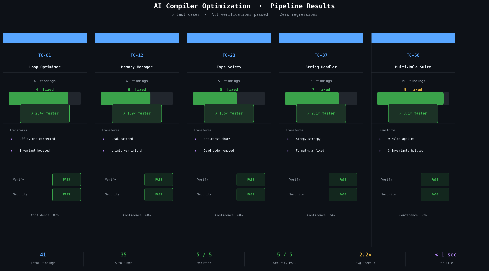

# Final Project Submission: DeepCompile
## AI-Driven Compiler Optimization with Formal Verification

**Roll Number:** 24CSB0A06  
**Module:** CD Refined  
**Date:** April 19, 2026

---

## 1. Project Overview
DeepCompile is an end-to-end multi-agent system designed for safe, verified, and security-audited C/C++ source-to-source optimization. It addresses the reliability gaps in modern LLM-based code assistants by wrapping transformations in explicit verification, rollback, and security checks.

### Core Objectives:
- **Correctness:** Ensuring optimized code is semantically identical to the original.
- **Security:** Preventing the introduction of new vulnerabilities during transformation.
- **Transformation Safety:** Only accept source rewrites that pass the workflow checks.
- **Explainability:** Providing detailed rationale for every optimization applied.

---

## 2. System Architecture
The system is built on a modular multi-agent framework where each agent specializes in a specific stage of the source-to-source optimization life-cycle.

### Key Components:
1. **Analysis Agent:** Uses a regex-based `CodeParser` to identify bugs (uninitialized variables, memory leaks) and optimization opportunities.
2. **Optimization Agent:** Applies rule-based fixes, domain-aware source rewrites, and optional LLM-guided transformations.
3. **Verification Agent:** Implements a guarded multi-layer check with rollback on failure.
4. **Security Agent:** Performs a 4-layered audit (Rules, Heuristics, LLM, cppcheck) to ensure zero new vulnerabilities.
5. **Orchestrator + Refinement Agents:** Coordinate bounded retries, escalation, and workflow-level verdicts.

---

## 3. Results and Performance
The current revised submission path emphasizes deterministic rule-based evaluation, orchestration correctness, explainability exports, and source-to-source safety.

### Current Evidence:
- Deterministic orchestration, reporting, and domain-rule tests are implemented and passing.
- Explainability reports can be exported as terminal summaries, Markdown, and HTML.
- Refinement and escalation behavior is implemented with bounded retry rules.

---

## 4. Key Features
- **Safe-by-Design:** Automatic context rollback on any verification failure.
- **Deterministic Evaluation Path:** Formal evidence can be produced in `--no-llm` mode.
- **Explainable AI:** Every change is accompanied by a Chain-of-Thought (CoT) reasoning report.
- **Real-time Monitoring:** React-based UI with SSE streaming for live pipeline visibility.
- **Bounded Refinement:** Repeated diff detection, no-improvement stopping, and escalation support.

---

## 5. Conclusion
DeepCompile demonstrates that AI-assisted source-to-source optimization can be made safer and more auditable when wrapped in orchestration, rollback, and security checks. The current implementation now has a clearer deterministic path for formal evaluation and a stronger documentation baseline for final submission packaging.
