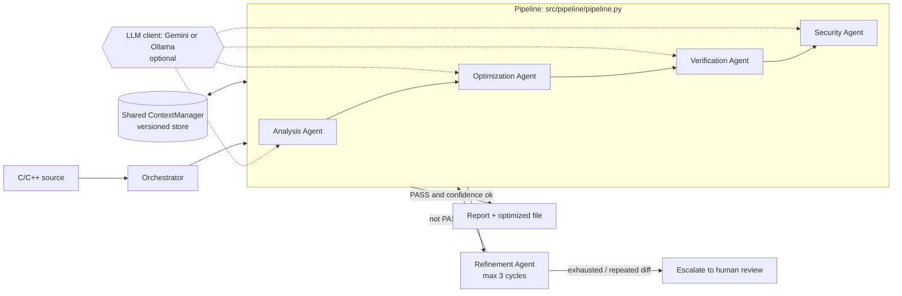

# DeepCompile: A Hybrid Rule-Based and LLM-Assisted Multi-Agent Pipeline for C/C++ Defect Detection, Conservative Transformation and Verification

**Authors:** [to be filled in]  **Affiliation:** [to be filled in]
**Status:** draft for a local-conference submission. All numbers in Section 6 are generated from result files under `Report/experiments/` by `evaluation/make_paper.py`; the build fails if any number lacks a source.

---

## Abstract

DeepCompile is a pipeline of four cooperating software agents (Analysis, Optimization, Verification, Security) that examines C/C++ source for defects, applies conservative source-level transformations, checks that each transformation preserves observable behaviour, and audits the result for newly introduced vulnerabilities. A bounded orchestration layer retries failed runs. Each agent combines a deterministic rule layer, which always runs, with an optional large-language-model (LLM) layer behind a common client interface, so the system degrades gracefully when no model is reachable. A Flask/React front end streams the agents' progress to the user.

We evaluate the deterministic core on a benchmark of {{n_cases_total}} small C/C++ programs, most seeded with one intended defect ({{n_headline}} single-defect cases form the headline set). The rule-only system identifies the intended defect class in {{dc_det}} of {{n_headline}} cases ({{dc_det_pct}} %), against {{gcc_det}} of {{n_headline}} ({{gcc_det_pct}} %) for `g++ -O2 -Wall -Wextra`. Its differential-testing safeguard rolled back {{n_rollback}} programs, but only {{rollback_with_transform}} of those had an applied transformation; the other {{rollback_no_transform}} were false alarms on programs with undefined output. However, when we compare program output with reference solutions, the pipeline produced **{{sol_corrected}} output-verified corrections** among {{sol_checked}} checkable cases, and speedups were indistinguishable from timer noise. We therefore position the contribution as an architecture and a measurement methodology: a layered detect-transform-verify-audit design with explicit rollback, an evaluation protocol that avoids circular scoring, and an honest account of which components work today and which are optional extensions. LLM-assisted layers are implemented for two backends (Gemini and Ollama) but are **not quantitatively evaluated** here (Section 6.7).

**Keywords:** multi-agent systems, static analysis, program transformation, differential testing, LLM-assisted software engineering, C/C++.

---

## 1. Introduction

Large language models are increasingly applied to compiler and program-analysis tasks [cummins2024llmcompiler, ullah2024llms, xia2023practical]. Two obstacles limit their direct use on production C/C++: model output is not guaranteed correct, and evaluations of LLM-based tools frequently report improvements without independent confirmation that behaviour was preserved. DeepCompile takes the opposite stance. Deterministic components form the core and carry the guarantees we can state; the LLM is an optional enrichment that can be disabled without breaking the pipeline.

**Contributions.**
1. A four-agent detect → transform → verify → audit pipeline with a bounded orchestration/refinement layer and rollback on verification or security regression (Section 4).
2. A graceful-degradation design in which every agent has a deterministic rule layer and an optional LLM layer behind one interface (Section 4.3).
3. An evaluation protocol that fixes ground truth from the *intended* bug of each benchmark program, scores at category level, separates "within detector coverage" from "overall", reports an independent compiler baseline, and distinguishes real output corrections from no-op matches (Section 5).
4. A candid component inventory: what works, what is an optional extension, and the concrete fix for each (Sections 7 and 8).

**Scope.** This paper does not claim formal equivalence checking, general-purpose optimization speedups, or LLM accuracy results; Sections 6 and 9 explain why.

---

## 2. Related Work

*Machine learning for compilers.* Surveys by Wang and O'Boyle [wang2018ml] frame the use of learning in compiler optimisation; recent work trains foundation models on compiler intermediate representations and assembly [cummins2024llmcompiler]. DeepCompile differs in scope: it operates on source text with rule-based transformations and uses an LLM only as an optional reviewer.

*LLMs for vulnerability detection and repair.* Ullah et al. report that LLMs cannot yet reliably identify and reason about security vulnerabilities [ullah2024llms]. LLM-based repair has shown promise [xia2023practical, pearce2023zeroshot], but generated patches require validation. Our verification layer addresses exactly this validation gap with differential execution.

*Multi-agent LLM frameworks.* AutoGen [wu2023autogen], MetaGPT [hong2023metagpt] and ChatDev [qian2024chatdev] orchestrate several LLM agents through conversation. DeepCompile's agents are specialised software components that share a versioned context store; the LLM is an optional component inside them, and the agents communicate by direct calls with an observable message trace (Section 4.2).

*Testing and validation of compilers and transformations.* Csmith [yang2011csmith] popularised randomized differential testing; Alive2 [lopes2021alive2] performs bounded translation validation of LLVM optimisations. Our differential tester is a much simpler, single-input variant of the former idea; we make no equivalence claims of the latter kind.

*Chain-of-thought prompting.* Our LLM layers request structured step-by-step output in the style of [wei2022cot] and validate it against a schema before use (Section 4.3).

*Weakness taxonomies.* Detector categories and security checks are aligned with CWE [mitre-cwe] and the SEI CERT C coding standard [sei-certc].

---

## 3. System Overview

DeepCompile consumes a C/C++ file and returns (i) a list of findings, (ii) an optimised version of the file with a unified diff and a list of applied transformations, (iii) a verification verdict (PASS / ROLLBACK), and (iv) a security audit with an overall risk rating. If verification or the security audit fails, the original code is kept. Results are available through three interfaces: command-line scripts (`run_pipeline.py`, `run_optimizer.py`, `run_agent.py`), a REST/SSE backend (`app.py`), and a React/Monaco web editor with per-mode runs (analyze, optimize, verify, security, full pipeline), an on-demand security scanner with one-click fixes, and a run-footprint (energy/emission) estimate.

---

## 4. Architecture



### 4.1 Pipeline stages

| Stage | Responsibility | Core (works today) | Source |
|---|---|---|---|
| Analysis | Parse structure; detect defects | Regex-based parser; rules for uninitialised variables, off-by-one loops, buffer-index heuristics, memory-leak counting, division by a zero-assigned variable, int-from-string-literal, empty `if`/`else`, dead code after `return`, loop invariants | `src/agents/analysis_agent.py:77-164, 168-437`; `src/parser/code_parser.py` |
| Optimization | Apply conservative source transformations | Initialise variables, fix off-by-one, hoist loop invariants, remove empty blocks / dead code, pre-increment, domain rules; emits a unified diff | `src/agents/optimization_agent.py:88-179, 183-308` |
| Verification | Check that behaviour is preserved | Compile both versions with `g++`, run, compare stdout; compile failure of the optimised version triggers rollback | `src/agents/verification_agent.py:94-219`; `src/verification/diff_tester.py:53-120` |
| Security | Audit for (new) vulnerabilities | Layer 1 unsafe-function rules (`gets`, `strcpy`, `sprintf`, ...), format strings, hard-coded secrets, use-after-free; Layer 2 heuristics (taint, unchecked `malloc`, integer overflow in allocation size, ...); *new* findings (by type) that are HIGH and rule/heuristic-sourced trigger rollback | `src/agents/security_agent.py:152-280, 284, 418`; standalone scanner `src/security/security_scanner.py:129-202`; auto-fixer `src/security/security_fixer.py:28-70` |

### 4.2 Shared context, orchestration and message trace

All agents of a run share a thread-safe, versioned `ContextManager` (`agent_framework/context_manager.py`) that stores the original code, analysis results, optimisation suggestions, verification status and security findings, with snapshot-based rollback. The `OrchestratorAgent` runs the pipeline once and accepts a clean result immediately; otherwise it hands over to the `RefinementAgent`, which runs up to three cycles and stops on success, on a security rollback, on a repeated diff signature, or when no material improvement is made (`src/agents/orchestrator_agent.py:67-186`, `src/agents/refinement_agent.py:83-292`).

*Accuracy note on "multi-agent".* The agents are invoked directly by the pipeline. `Pipeline._route` creates `Message` objects (request / response / notification) and passes them to an observer that streams them to the UI and logs them (`src/pipeline/pipeline.py:126-153`); no agent reads another agent's queue. The queue-and-thread messaging framework in `agent_framework/` exists and is exercised only by test agents. We describe the system as agents with a shared context and an observed message trace, not as autonomously negotiating agents.

### 4.3 Graceful degradation: rule layer first, LLM optional

Every agent first runs its deterministic layer. If an LLM client reports itself available, the agent additionally asks it for structured JSON (reasoning steps, findings, confidence, and—for the optimizer—a full rewritten file). The reply is parsed and schema-checked by `CoTValidator` (`src/reasoning/cot_validator.py:50-119`); any failure (unreachable model, stub reply, invalid JSON) silently falls back to the rule-only result. Two interchangeable backends implement the client interface: Ollama (default model `qwen2.5-coder:7b`) and the Gemini API (`gemini-2.5-flash` by default) (`src/llm/llm_client.py:44-287`). Per-agent in-memory LRU caches avoid recomputing identical work (`src/runtime_cache.py`).

### 4.4 Front end and streaming

`app.py` runs each request in a worker thread that pushes typed events (status, log, agent_message, per-agent results, final summary) into a queue consumed by a Server-Sent-Events response (`app.py:41-60, 661-700`); the React client renders them as tabs (analysis, optimized diff with accept/undo, verification layers, security findings, message log).

---

## 5. Methodology

### 5.1 Benchmark and ground truth

The corpus (`MicroBenchmarks/Testcases`) contains {{n_cases_total}} programs, `TC01`–`TC57` plus `TestCase1` (one byte-identical duplicate of TC19 is excluded). Most programs are small and each is seeded with one defect from one of 13 groups (uninitialised data, division by zero, array/buffer bounds, memory management, pointer misuse, integer arithmetic, logic/control flow, resource leaks, type conversion, input/format/injection, concurrency, object slicing, multi-rule). Reference fixes exist for `TC01`–`TC55`.

**Ground truth was frozen before any run** (`Report/experiments/expected_categories.json`, `category_map.json`) and was assigned from each program's *intended* defect, not from what the detectors emit. The **headline set** is {{n_headline}} single-defect cases (`TC01`–`TC55` minus `TC40`, whose unclosed `ifstream` is released by RAII and is arguably not a bug). `TC56` (built to trigger every rule), `TC57` and `TestCase1` are multi-defect cases scored per case.

### 5.2 Category-level scoring

Detector types and LLM-style free-form labels are mapped to bug categories by one ordered keyword map applied identically to DeepCompile and to the baseline. A case is *detected* when a finding of its intended category is reported on the original program. We report two denominators and define both: **overall** (all {{n_headline}} headline cases; cases with no applicable detector count as misses) and **within detector coverage** (the {{n_supported}} cases whose category is emitted by at least one detector in the code base; {{n_unsupported}} headline cases are outside it). Coverage is judged at category level, which is an upper bound: a category can be reachable through an unrelated detector.

### 5.3 Correction metrics

"Corrected" is measured two ways, deliberately labelled: **detector-judged** (the defect category was detected before and is absent after the pipeline, using the same rule detectors, hence circular) and **output-verified** (for deterministic, compilable programs with a reference solution, the optimised program's output and exit code equal the solution's while the original's did not). The output-verified comparison is split into four outcomes: corrected, bug-not-visible-in-output, not-fixed, regression. The reference-solution check requires the program to compile with the available toolchain, to be deterministic, and to run under empty standard input.

### 5.4 Baseline

`g++ -O2 -Wall -Wextra -c` warnings on the same programs, mapped through the same category map. No clang/clang-tidy, cppcheck or Z3 was available on the evaluation machine, so this is the only independent baseline.

### 5.5 Performance and verification protocol

Speed is measured by a separate, sequential script after all pipeline runs (no concurrent CPU load): original and optimised code are each compiled at `-O0` with an in-process timer and run ten times; the minimum is used. Only cases whose verification passed and whose code changed are measured. Timings below 1 ms are flagged as below the noise floor; runs that produce no timing line (crash, undefined behaviour, compile failure) are reported as n/a, never as 0 %.

Every case runs in its own subprocess with a 300 s limit, so module-level caches cannot leak between cases or configurations, and optimiser output is redirected away from the tracked repository folder.

---

## 6. Experimental Results

**Setup.** {{os}}; Python {{python}}; {{compiler}}. Configurations: *rule-only basic pipeline*, *rule-only orchestrated pipeline*, *g++ baseline*. All executions use empty standard input. Complete raw per-case JSON and CSV files are in `Report/experiments/`.

### 6.1 Detection

{{T_DETECTION}}

Detection is identical for the two rule-only pipeline configurations ({{dc_det}} vs {{orch_det}} cases) because detection runs before either pipeline; we therefore report it once. Only {{n_supported}} of {{n_headline}} headline cases lie within the detectors' category coverage, so the "overall" rate is bounded by the breadth of the rule set, and the "within coverage" rate is recall restricted to the categories the rules can emit. "Coverage" in the table is DeepCompile's coverage, applied to both systems for comparability. It is category-level only; a stricter inventory of which individual programs have any applicable detector was not used as a second denominator.

{{T_CATEGORY}}

The multi-defect programs, reported per case (TC56 was designed to trigger the rules, so its result is a rule-coverage check and not a generalisation estimate):

{{T_MULTI}}

TC56: {{tc56_hit}}/{{tc56_n}} categories; TC57: {{tc57_hit}}/{{tc57_n}}; TestCase1: {{tc1_hit}}/{{tc1_n}}.

### 6.2 Own-class findings persisting on the fixed program

Running the same rule detectors on the reference solutions, the intended category was still reported in {{fp_sol}} of {{fp_sol_den}} programs ({{fp_sol_cases}}). This is not a general false-positive rate: it measures how often a rule keys on a code pattern that the correct fix leaves in place (for example, a guarded division or an `i <= n` loop with an adjusted bound).

### 6.3 Transformation, verification and rollback

{{T_PIPELINE}}

In the basic configuration {{n_with_transform}} of {{n_ok_rows}} completed cases received at least one transformation ({{n_transform_total}} applications of {{n_transform_types}} transformation types; {{n_code_changed}} cases ended with changed code). Verification rolled back {{n_rollback}} programs ({{rollback_cases}}). Of these, {{rollback_no_transform}} ({{rollback_no_transform_cases}}) had **no transformation applied**, so the rollback is a verification false alarm on a program whose output is undefined or run-dependent, not a caught unsafe change; {{rollback_with_transform}} ({{rollback_with_transform_cases}}) rolled back an actual transformation. The safeguard is therefore demonstrated mechanically but its precision on this corpus is low. Separately, {{n_timeout}} case ({{timeout_cases}}) exceeded the 300 s limit (an infinite-loop program makes the differential test and the ten performance runs each wait for their time-outs). The longest completed run ({{slowest_case}}) reads standard input, which is empty here, and waits on time-outs; the rule layer itself is fast.

{{T_TRANSFORMS}}

*Orchestration.* The orchestrated configuration escalated {{orch_escalated}} cases to human review ({{orch_escalated_cases}}) after refinement. The only case whose verification verdict changed from ROLLBACK (basic) to PASS (orchestrated) was {{orch_flip_cases}}; the underlying program has undefined behaviour with run-dependent output, so this is evidence of **verification flakiness on non-deterministic programs**, not of the refinement loop improving the result.

### 6.4 Correctness of the transformations

{{T_CORRECTION}}

Detector-judged correction reached {{det_corrected}} of {{det_corrected_den}} cases in which the defect had been detected ({{det_corrected_cases}}); all four are uninitialised-variable initialisations, where program output is undefined and therefore excluded from the output-verified comparison. Among the {{sol_checked}} checkable cases there are **{{sol_corrected}} output-verified corrections** and {{sol_regression}} regressions. Of the {{sol_not_fixed}} 'not fixed' cases, {{not_fixed_unchanged}} had no code change at all (not attempted rather than attempted and failed); reference solutions may also print different diagnostics, so this is a strict metric. The "bug-not-visible" group (for example leaks, which do not change printed output) shows why a bare "output matches the solution" statistic would overstate correction: those programs matched before any change.

### 6.5 Performance

{{T_PERF}}

Of {{perf_rows}} measured cases, {{perf_valid}} produced a valid timing; {{perf_noise}} of those are below the 1 ms noise floor, and every valid measurement lies between {{perf_min}} % and {{perf_max}} % with a largest absolute time of {{perf_max_ms}} ms. We therefore make **no speedup claim**: the applied transformations (initialisation, dead-code removal, `++i`) target correctness and style, and the corpus consists of microsecond-scale programs.

### 6.6 Pipeline latency

The median rule-only pipeline run took {{pipe_median_s}} s per program and the longest completed run {{pipe_max_s}} s ({{slowest_case}}, excluding the timed-out case).

### 6.7 LLM-assisted layers (not evaluated)

Both backends are implemented behind one interface and are exercised in the UI. A quantitative Gemini run was attempted but is **invalid and excluded**: the free-tier API allowed 20 requests per day per model, was exhausted within the first few programs, and the system then fell back to its rule layer for almost every call (the harness now rejects any row containing a stub reply). Ollama is supported through the same interface but was not run in this study. The quarantined files are kept in `Report/experiments/invalid_runs/` for transparency. Consequently no claim in this paper depends on LLM output. **[Placeholder: insert Gemini/Ollama results here once a billed key or local model is available.]**

---

## 7. Advantages (what works today)

1. **Deterministic, offline core.** All headline results are reproducible without network access or a model; the LLM can be disabled by a switch.
2. **Layered safety.** Transformations are gated by compilation/differential execution and by a security comparison between original and optimised code; either failure restores the original.
3. **Explainable output.** Every transformation is reported with a type, description and unified diff, and every run carries a reasoning/message trace and a shared-context history.
4. **Broader than a compiler baseline on its own bug classes.** On this corpus the rule layer identified the intended defect in {{dc_det}} cases against {{gcc_det}} for `g++ -O2 -Wall -Wextra`, and flags categories the baseline did not report on this corpus (hard-coded secrets, command injection, use-after-free patterns).
5. **Practical tooling.** CLI, REST/SSE service and an interactive editor with accept/undo, one-click security fixes and per-run energy estimates.
6. **Graceful degradation and caching** keep the tool usable when the model is slow or unavailable.

## 8. Limitations and Optional Modules (future extensions)

The table separates what is part of the validated core from components that exist in the code base but need a fix before they can be claimed. Each entry lists the concrete fix.

| Optional module / limitation | Current state | Fix (location) | What it would enable |
|---|---|---|---|
| LLM-guided refinement | The refinement agent disables the **shared** LLM client in cycle 1 and never restores it, so "LLM-guided" cycle 2 is rule-only and repeats cycle 1's diff | Use a per-cycle client copy (`src/agents/refinement_agent.py:147-149`) | Real iterative repair |
| LLM layers (Gemini / Ollama) | Not evaluated; 2048-token cap can truncate a full-file JSON reply; caches ignore backend/LLM setting | Raise `max_tokens`, add backend to cache keys (`src/llm/llm_client.py:76`, `src/agents/analysis_agent.py:87`, `src/agents/optimization_agent.py:99`) | Comparative LLM results |
| Speedup measurement | Harness repaired in this work (it never linked; timer resolution ~15 ms on MinGW GCC 6); numeric speed-up is not yet returned in the verification result | Expose `speedup_pct` in `VerificationAgent` output (`src/agents/verification_agent.py:197-213`) | Speed claims on compute-heavy kernels |
| Formal equivalence (Z3) | Skipped (`z3-solver` not installed); the extractor only handles a file with exactly one `return` | `src/verification/z3_verifier.py:51-66`, `:147-155` | Proof for simple arithmetic rewrites |
| True inter-agent messaging | Messages are logged, not delivered; the queue framework has a priority-tie comparison bug | `src/pipeline/pipeline.py:126-153`, `agent_framework/base_agent.py:161` | Genuinely decoupled agents |
| Safe strength reduction | `a + b * 2` becomes `a + b << 1` (precedence), `f / 2.0` becomes `f >> 1.0`; applies inside strings/comments | Parse operands and types before rewriting (`src/agents/optimization_agent.py:502-533`) | Valid arithmetic speed-ups |
| Targeted off-by-one fix | Rewrites every `<= N` loop, including legitimate inclusive loops | Require a related array access (`src/agents/optimization_agent.py:310-317`) | Fewer regressions |
| Per-transformation rollback | One failing transformation discards all | Bisect transformations on verification failure (`src/agents/verification_agent.py:173-182`) | Keep the good fixes |
| Memory-leak fix | Inserts `free(x)` before every `return <int>` in the file regardless of scope | Scope-aware insertion (`src/agents/optimization_agent.py:405-426`) | Safe leak repair |
| Literal division by zero | `x / 0` is not reported by the rule layer | Handle numeric-literal divisors (`src/agents/analysis_agent.py:249-273`) | Closes TC06-type misses |
| Format-string rule in the Security Agent | Treats the first argument of `sprintf`/`fprintf` as a format string, so ordinary calls are flagged | Match the scanner's rule (`src/agents/security_agent.py:102-105` vs `src/security/security_scanner.py:72-75`) | Fewer false positives |
| New-vulnerability comparison | Compares by finding *type*, so a second instance of an existing type is not "new" | Compare by (type, normalised location) (`src/agents/security_agent.py:793-801`) | Stricter rollback |
| Streaming robustness | The SSE queue gives up after 180 s of silence while a model call may take up to 360 s × 3 | Heartbeat events (`app.py:58`, `app.py:683`) | Reliable long runs |
| Verification of non-deterministic / non-terminating programs | Output comparison is meaningless for programs with undefined behaviour (we observed a rollback/pass flip); infinite loops exhaust the time budget | Detect UB-prone programs; shorter time-outs; sanitizer builds (`src/verification/diff_tester.py`, `src/verification/perf_benchmarker.py`) | Trustworthy verdicts on UB code |
| Static-analysis integrations | cppcheck layer inactive (not installed); no clang-based oracle | `src/agents/security_agent.py:712`; add clang-tidy | Independent ground truth |
| Hardware energy measurement | Metrics from the monitor are never passed to the estimator (they are read after the run) | Start/stop the monitor around the run and forward the result (`app.py:484`) | Measured, not estimated, energy |

**Other limitations.** Detection is regex-based and therefore pattern- and style-sensitive; {{n_unsupported}} of the {{n_headline}} headline cases fall outside any detector's category. The optimiser's changes are small (initialisation, dead code, pre-increment) and by themselves do not produce output-verified corrections on this corpus. The web layer shares loggers and caches across concurrent requests and is intended for single-user use.

## 9. Threats to Validity

- **Synthetic, small corpus.** {{n_cases_total}} programs, mostly under a few dozen lines, authored by the project team; results do not estimate performance on real code bases.
- **Author-assigned ground truth.** Categories were frozen before running but are still the authors' judgement; category-level matching and the keyword map are generous in places (coverage is an upper bound) and strict in others.
- **Circular detector-judged correction.** The same rules judge the before and after states; it is reported only as such.
- **Undefined behaviour.** Many programs have undefined or run-dependent output; output-verified correction is available only for the deterministic, compilable subset ({{sol_checked}} cases), and verification itself can flip on non-deterministic programs.
- **Toolchain.** MinGW GCC 6.3 lacks `std::thread`/`std::mutex`, so two concurrency programs could not be compiled or executed; the benchmark timer needed a platform-specific correction.
- **Empty standard input** for all executions; input-dependent bugs are exercised only through static detection.
- **Single machine, single run.** No repeated trials across machines.
- **No LLM results** are reported, so conclusions about LLM contribution cannot be drawn from this study.

## 10. Conclusion and Future Work

DeepCompile contributes a layered detect–transform–verify–audit architecture with rollback and graceful degradation, together with an evaluation protocol designed to avoid the common pitfalls of circular scoring and no-op "correct output" matches. Its deterministic core identified the intended defect in {{dc_det_pct}} % of the headline cases (vs {{gcc_det_pct}} % for a compiler-warning baseline), but did not produce output-verified corrections, and its measurable speedups were within noise; we report this plainly. The most valuable next steps, in order, are: repairing the unsafe transformations and the refinement loop (Section 8), widening the detector set to cover the {{n_unsupported}} uncovered cases, adding sanitizer-based verification, and then running the Gemini and Ollama backends over the full benchmark with a billed or local model.

---

## References

*(Each entry was opened and confirmed against the cited source by a verification pass; arXiv-only items are cited as preprints. Venue details marked † were confirmed from search-result records only.)*

- [wang2018ml] Z. Wang and M. O'Boyle, "Machine Learning in Compiler Optimisation," *Proceedings of the IEEE*, 2018. arXiv:1805.03441.
- [cummins2024llmcompiler] C. Cummins, V. Seeker, D. Grubisic, B. Roziere, J. Gehring, G. Synnaeve, H. Leather, "Meta Large Language Model Compiler: Foundation Models of Compiler Optimization," arXiv:2407.02524, 2024 (preprint).
- [ullah2024llms] S. Ullah, M. Han, S. Pujar, H. Pearce, A. Coskun, G. Stringhini, "LLMs Cannot Reliably Identify and Reason About Security Vulnerabilities (Yet?): A Comprehensive Evaluation, Framework, and Benchmarks," IEEE S&P 2024. arXiv:2312.12575.
- [xia2023practical] C. S. Xia, Y. Wei, L. Zhang, "Practical Program Repair in the Era of Large Pre-trained Language Models," ICSE 2023. arXiv:2210.14179.
- [pearce2023zeroshot] H. Pearce, B. Tan, B. Ahmad, R. Karri, B. Dolan-Gavitt, "Examining Zero-Shot Vulnerability Repair with Large Language Models," IEEE S&P 2023. arXiv:2112.02125.
- [wu2023autogen] Q. Wu, G. Bansal, J. Zhang, et al., "AutoGen: Enabling Next-Gen LLM Applications via Multi-Agent Conversation," arXiv:2308.08155, 2023 (preprint).
- [hong2023metagpt] S. Hong, M. Zhuge, J. Chen, et al., "MetaGPT: Meta Programming for a Multi-Agent Collaborative Framework," arXiv:2308.00352, 2023 (preprint).
- [qian2024chatdev] C. Qian, W. Liu, H. Liu, et al., "ChatDev: Communicative Agents for Software Development," ACL 2024. arXiv:2307.07924.
- [wei2022cot] J. Wei, X. Wang, D. Schuurmans, et al., "Chain-of-Thought Prompting Elicits Reasoning in Large Language Models," arXiv:2201.11903, 2022 (preprint).
- [yang2011csmith] X. Yang, Y. Chen, E. Eide, J. Regehr, "Finding and Understanding Bugs in C Compilers," PLDI 2011, pp. 283-294. †
- [lopes2021alive2] N. P. Lopes, J. Lee, C.-K. Hur, Z. Liu, J. Regehr, "Alive2: Bounded Translation Validation for LLVM," PLDI 2021, pp. 65-79. †
- [mitre-cwe] MITRE Corporation, "Common Weakness Enumeration (CWE)," https://cwe.mitre.org/.
- [sei-certc] Software Engineering Institute, Carnegie Mellon University, "SEI CERT C Coding Standard," https://cmu-sei.github.io/secure-coding-standards/sei-cert-c-coding-standard/.

## Appendix A. Reproducing the experiments

```
python evaluation/build_expected_categories.py            # freeze ground truth + category map
python evaluation/paper_experiments.py run --config gpp_wall
python evaluation/paper_experiments.py run --config rule_basic
python evaluation/paper_experiments.py run --config rule_orch
python evaluation/paper_experiments.py summarize --config <config>
python evaluation/paper_perf.py rule_basic                 # run with no other CPU load
python evaluation/paper_postpass.py rule_basic             # output-vs-reference outcomes + environment.json
python evaluation/make_paper.py                            # renders this document; fails on any unsourced number
pytest tests/test_paper_metrics.py tests/test_perf_benchmarker.py
```

## Appendix B. Change made to the system under test

Only the performance **measurement instrument** (`src/verification/perf_benchmarker.py`) was modified before measuring: `#undef main` before the timing wrapper (the original harness could never link), an overload shim for `int main()` / `int main(void)` / `int main(int, char**)`, and a second translation unit using `QueryPerformanceCounter` on Windows so user macros such as `SIZE` do not clash with `<windows.h>`. All other components were measured as they were; their known defects are listed in Section 8.
